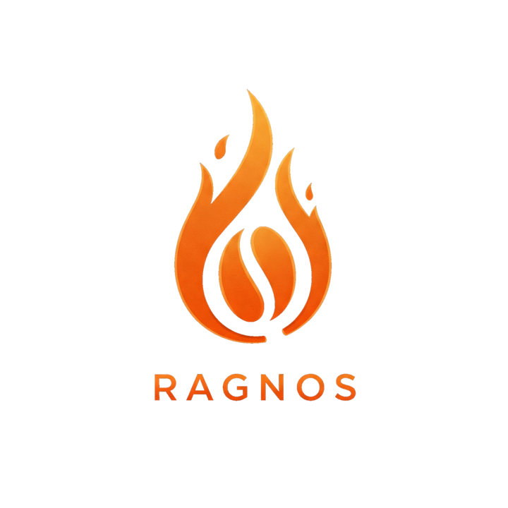

# 🚀 Ragnos Framework

<div align="center">



**⚡ The Declarative PHP Framework for Modern Development**

**Build secure, enterprise-grade applications in record time** using **Configuration over Programming** and **AI Vibecoding**.

> Stop writing repetitive code. Ragnos automatically generates APIs, UIs, and complex validations from your data models.

---

## 📚 Official Manual Available Now!

**Learn Ragnos from zero to pro** with our comprehensive guides:

[](https://leanpub.com/ragnosfromzerotopro)
[](https://leanpub.com/ragnosdeceroapro)

</div>

---

## 💡 What is Ragnos?

**Ragnos** is a modern, lightweight PHP framework that revolutionizes web application development through declarative programming. Built on the solid foundation of **CodeIgniter 4**, it integrates **Vanilla JavaScript**, **DataTables 3**, and **AdminLTE 4** to deliver a complete, efficient development experience.

### Core Philosophy

Instead of writing boilerplate code, you define your data structure and business rules once—Ragnos handles the rest. Controllers, views, APIs, validations, and UI components are generated automatically.

## ✨ Key Features

| Feature                         | Benefit                                                                                       |
| ------------------------------- | --------------------------------------------------------------------------------------------- |
| **💾 Declarative Datasets**     | Define data structure once, get a fully functional CRUD module with APIs automatically        |
| **🔌 Hybrid Core (HTML + API)** | Your admin panel automatically serves as a secure RESTful API for mobile and modern frontends |
| **🛡️ Enterprise Security**      | RBAC, immutable audit logs, and automatic OWASP Top 10 mitigation out of the box              |
| **⚡ Zero Configuration**       | Works instantly with smart defaults; customize only what you need                             |
| **📊 Advanced Data Tables**     | Built-in search, filtering, pagination, and sorting with DataTables integration               |
| **🎨 Beautiful UI**             | AdminLTE 4 provides a modern, fully responsive interface ready for production                 |
| **🚀 Native REST API**          | Expose your data to mobile apps and SPAs with integrated token-based security                 |
| **📱 Responsive Design**        | Mobile-first approach ensuring perfect display on all devices                                 |

## 🏗️ Built on Proven Technology

**Ragnos leverages industry-standard technologies:**

- **CodeIgniter 4** — Ultra-lightweight PHP framework with minimal learning curve
- **AdminLTE 4** — Modern dashboard UI built on Bootstrap 5, fully customizable and responsive
- **Vanilla JavaScript & DataTables 3** — Robust client-side data manipulation without jQuery or build complexity
- **Bootstrap** — Responsive design framework for consistent, professional appearance
- **MariaDB/MySQL** — Powerful relational database support with advanced querying

## 🚀 Quick Start

### Installation

Choose the method that best fits your workflow:

- **Quick Standalone ZIP (No Composer or Git needed)**:  
  Download the ready-to-use **[ragnos.zip](https://github.com/cgarciagl/Ragnos/releases/latest/download/ragnos.zip)** (includes CodeIgniter 4 and all dependencies pre-installed in `vendor/`) and extract it into your web server directory.

- **Via Git & Composer (Recommended for active development)**:  
  ```bash
  git clone https://github.com/cgarciagl/Ragnos.git mi-proyecto && cd mi-proyecto
  composer install
  ```

### Configuration & Database
3. **Configure** the environment:
   - Copy `.env.example` to `.env` (never commit `.env`)
   - Update database credentials and base URL
4. **Create** the database (named as in your `.env`, `ragnos` by default) and import the system tables:
   ```bash
   mysql -u root -p ragnos < sampledatabase/ragnos_base.sql
   ```
   > 💡 Prefer a GUI? Try **[PyroStudio](https://github.com/cgarciagl/PyroStudio)**, the native MariaDB/MySQL client by the author of Ragnos: right-click the database → *Backup / Restore* → *Restore into Existing DB*.
5. *(Optional)* **Load the demo** — a scale-model store with catalogs, reports and a sales dashboard:
   ```bash
   mysql -u root -p ragnos < sampledatabase/demo_classicmodels.sql
   ```
6. **Access** your application at the configured URL (e.g., `http://localhost/mi-proyecto/public`) and sign in with `admin` / `admin`

> For detailed installation instructions, see the [Official Documentation](https://ragnos.build/docs/) or the book [Ragnos from Zero to Pro](https://leanpub.com/ragnosfromzerotopro)

### Create Your First Dataset

1. **Create the database table** (SQL):

```sql
CREATE TABLE `tasks` (
  `id_task` int(11) NOT NULL AUTO_INCREMENT,
  `title` varchar(100) NOT NULL,
  `description` text,
  `status` enum('pending','in_progress','completed') DEFAULT 'pending',
  PRIMARY KEY (`id_task`)
) ENGINE=InnoDB DEFAULT CHARSET=utf8mb4;
```

2. **Generate the controller** in your terminal:

```bash
php spark ragnos:make Modules/Tasks -table tasks
```

3. **Configure your dataset** in `app/Controllers/Modules/Tasks.php`:

```php
namespace App\Controllers\Modules;

use Ragnos\Controllers\RDatasetController;

class Tasks extends RDatasetController
{
    public function __construct()
    {
        parent::__construct();
        $this->checkLogin();
        $this->setTitle('Tasks Management');
        $this->setTableName('tasks');
        $this->setIdField('id_task');

        $this->addField('title', [
            'label' => 'Task Title',
            'rules' => 'required|min_length[3]'
        ]);

        $this->addField('description', [
            'label' => 'Details',
            'type'  => 'textarea'
        ]);

        $this->addField('status', [
            'label' => 'Status',
            'type'  => 'select',
            'options' => [
                'pending' => 'Pending',
                'in_progress' => 'In Progress',
                'completed' => 'Completed'
            ]
        ]);

        $this->setTableFields(['title', 'status']);
    }
}
```

4. **Access in your browser** at `http://localhost/mi-proyecto/public/modules/tasks`

**That's it!** Ragnos automatically generates:

- ✅ Complete CRUD interface
- ✅ RESTful API endpoints
- ✅ Form validations
- ✅ Data security
- ✅ Search and filtering
- ✅ Automated reports and exports

## 📖 Documentation & Resources

- 📚 **[Official Manual](https://leanpub.com/ragnosfromzerotopro)** — Comprehensive guide to mastering Ragnos
- 🌐 **[Live Demo](https://ragnos.yupii.org/)** — See Ragnos in action
- 💬 **[Discord Community](https://discord.gg/4z7tCxA4Fp)** — Connect with developers and get support
- 🔗 **[GitHub Repository](https://github.com/cgarciagl/Ragnos)** — Source code and issue tracking

## ⚙️ Requirements

- **PHP 8.1** or higher, with the `intl`, `mbstring`, and `mysqli` extensions
- **Composer** 2.x
- **MariaDB 10.2.1+** or **MySQL 8.0+** (`RQueryController` relies on common table expressions, `WITH`)

## 🛠️ Available Commands

```bash
# List all available Ragnos commands
php spark list

# Generate a new Dataset Controller from database table
php spark ragnos:make Modules/Users -table users

# Generate a Query Controller from SQL query
php spark ragnos:make:query Dashboard/Reports -query "SELECT * FROM users"

# Start development server
php spark serve
```

## 🎯 Use Cases

✅ **Admin Panels** — Build feature-rich dashboards in hours, not weeks  
✅ **REST APIs** — Generate production-ready APIs automatically  
✅ **Mobile Backends** — Serve iOS/Android apps with built-in security  
✅ **MVPs & Prototypes** — Rapid application development for startups  
✅ **Enterprise Apps** — Scalable, secure, and maintainable applications

## 🤝 Contributing

We welcome contributions! Please feel free to submit pull requests or open issues for bugs and feature requests.

1. Fork the repository
2. Create your feature branch (`git checkout -b feature/amazing-feature`)
3. Commit your changes (`git commit -m 'Add amazing feature'`)
4. Push to the branch (`git push origin feature/amazing-feature`)
5. Open a Pull Request

## 📄 License

This project is licensed under the **MIT License** — see [LICENSE](LICENSE) file for details.

## 💡 Philosophy: Configuration Over Programming

Ragnos embodies the principle that **configuration should be preferred over writing repetitive code**. By declaratively describing what you need, the framework handles the implementation details, allowing developers to focus on business logic and user experience.

## 🌟 Recognition & Community

- ⭐ Star us on [GitHub](https://github.com/cgarciagl/Ragnos)
- 💬 Join our [Discord community](https://discord.gg/4z7tCxA4Fp)
- 📢 Follow us on social media for updates and announcements

---

<div align="center">

**Built with ❤️ for developers who value their time**

[GitHub](https://github.com/cgarciagl/Ragnos) • [Discord](https://discord.gg/4z7tCxA4Fp) • [Get the Book](https://leanpub.com/ragnosfromzerotopro)

</div>
