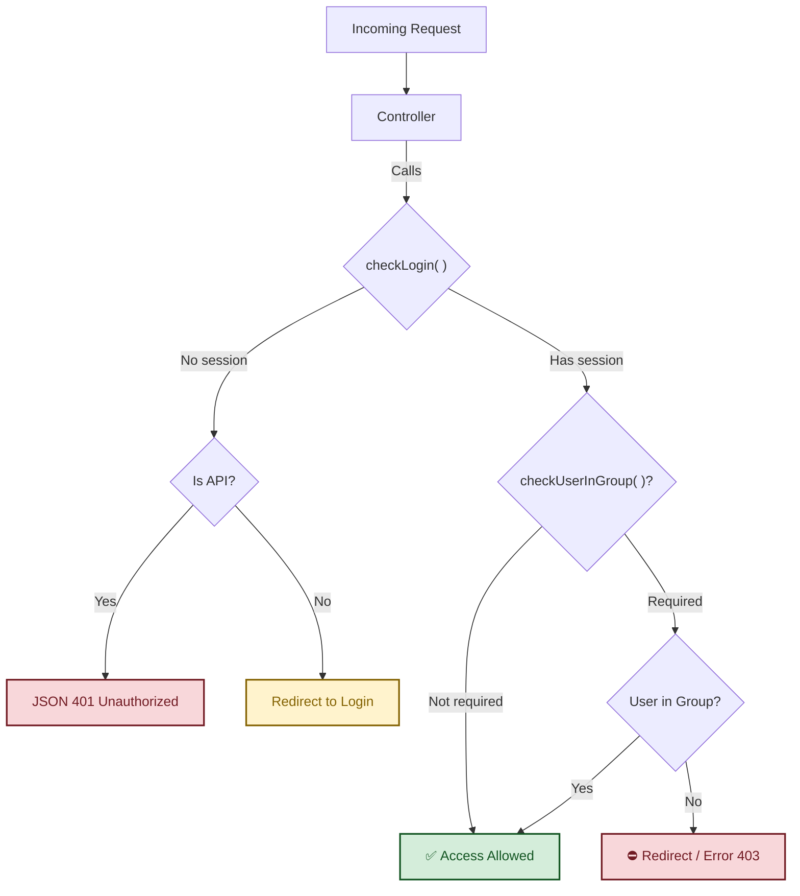

# Integrated Authentication and Permissions System

Ragnos includes a lightweight, flexible authentication system built directly into the framework core. It handles user sessions, controller protection, and Role-Based Access Control (RBAC).

The system relies mainly on the `App\Services\Admin_aut` service and the `BaseController` class.

## Database Tables

The system expects a specific database structure:

- **`gen_usuarios`**: The users table (`usu_id`, `usu_nombre`, `usu_login`, `usu_pword`, `usu_activo`, `usu_grupo`).
- **`gen_gruposdeusuarios`**: The roles table (`gru_id`, `gru_nombre`).

## Controller Protection

All controllers extending `BaseController` (including [`RDatasetController`](../datasets/datasets.md), [`RProcessController`](server_side_events.md), etc.) have access to simplified protection methods.

### Verification Flow



### `checkLogin()`

This method checks whether the user has an active session. If not:

1.  Web requests: it redirects to the login page (`admin/login`).
2.  API requests: it validates the `Authorization` header against `usu_token` in the database. If validation fails, it returns a 401 error in JSON.

**Usage:**
Call it at the start of any function that requires authentication, or in the constructor if the whole controller is private.

!!! tip "Public Controllers"

    If you have a public controller (e.g. Home page), simply do not call `checkLogin()`.

```php
public function myPrivateFunction()
{
    $this->checkLogin();

    // The rest of the code only runs if the user is logged in
    return view('my_view');
}
```

### `checkUserInGroup($groups)`

Restricts access to users who belong to the specified groups.

- **Parameter**: A `string` with the group name, or an `array` of strings for several groups.
- **Behavior**:
  - If the condition is not met, it redirects to `admin/index` (or returns 403/401 for API requests).
  - It calls `checkLogin()` internally, so you do not need to call both.

**Usage:**

```php
public function __construct()
{
    // Only allow access to administrators
    $this->checkUserInGroup('Administrador');
}

public function managementReport()
{
    // Allow administrators or management
    $this->checkUserInGroup(['Administrador', 'Management']);

    // Report logic...
}
```

---

## `Admin_aut` Service

For finer-grained logic inside views or controllers, use the authentication service directly.

The recommended way to get it is `service('Admin_aut')`.

### Main Functions

#### `isLoggedIn()`

Returns `true` if the user is logged in, and `false` otherwise.

```php
if (service('Admin_aut')->isLoggedIn()) {
    echo "User connected";
}
```

#### `id()`

Returns the current user's ID (`usu_id`).

#### `name()`

Returns the current user's full name (`usu_nombre`).

#### `isUserInGroup($group)`

Checks whether the current user belongs to the given group. It is useful for showing or hiding buttons in views, or for conditional logic. The comparison is case-insensitive.

```php
// In controller or view
if (service('Admin_aut')->isUserInGroup('Sales')) {
    // Show the create order button
}
```

#### `getField($fieldName)`

Gets any field of the current user from the `gen_usuarios` table. The data is loaded lazily on the first request.

```php
// Get email or custom field
$email = service('Admin_aut')->getField('usu_email');
```

---

## Driver Architecture (`RagnosAuthInterface`)

Starting with Ragnos Framework v1.1+, the authentication subsystem is decoupled under an **Adapter/Driver** pattern. This allows swapping the underlying authentication provider without breaking the documented public API (`service('Admin_aut')`, `$this->checkLogin()`, `$this->checkUserInGroup()`, audit logs, etc.).

### Available Drivers

1. **`native` (Default)**:
   - Built on native PHP sessions and the `gen_usuarios` and `gen_gruposdeusuarios` tables.
   - Includes Bearer token support for REST APIs, validated against `usu_token`.
   - Case-insensitive role comparison.
2. **`shield`**:
   - Direct integration with [CodeIgniter 4 Shield](https://shield.codeigniter.com/).
   - Maps calls to Shield APIs (`auth()`, `auth()->user()`, `auth('tokens')`, etc.).
   - If Shield is not installed in the project, the system automatically falls back safely to the native driver.

### Driver Configuration

You can define the active driver in `app/Config/RagnosConfig.php`:

```php
public string $authDriver = 'native'; // Options: 'native' | 'shield'
```

Or override it per environment in your `.env` file:

```ini
ragnos.authDriver = shield
```

### `RagnosAuthInterface` Contract Methods

All drivers implement `Ragnos\Auth\RagnosAuthInterface`:

| Method                         | Return Type | Description                                          |
| ------------------------------ | ----------- | ---------------------------------------------------- |
| `checkLogin()`                 | `bool`      | Returns `true` if a user is currently authenticated. |
| `isUserInGroup(string $group)` | `bool`      | Checks membership in the specified group.            |
| `getUserId()`                  | `?int`      | Unique user identifier or `null`.                    |
| `getUserName()`                | `?string`   | Authenticated username or `null`.                    |
| `getUserEmail()`               | `?string`   | User email address or `null`.                        |
| `logout()`                     | `void`      | Terminates the active session and credentials.       |
| `checkApiToken(string $token)` | `bool`      | Validates a Bearer token for API requests.           |

To guarantee 100% backward compatibility, both drivers and the `Admin_aut` service also support legacy methods: `$auth->isLoggedIn()`, `$auth->id()`, `$auth->name()`, `$auth->getField($field)`, and `$auth->checkUserInGroup($grupos)`.

---

## API Authentication

The system supports REST API authentication transparently.

1.  On login, a secure token is generated in `usu_token`.
2.  The client must send the token in the `Authorization` header.
3.  `checkLogin()` automatically detects API calls (`isApiCall()`) and validates the token instead of the PHP session.

This lets you use the same controllers for the web interface and for mobile apps or decoupled frontends.

## Complete Example

```php
<?php

namespace App\Controllers;

use Ragnos\Controllers\BaseController;

class Orders extends BaseController
{
    public function __construct()
    {
        // Load helpers
        helper(['form', 'url']);
    }

    public function index()
    {
        // 1. Make sure the user is logged in
        $this->checkLogin();

        $auth = service('Admin_aut');

        // 2. Get the user's data
        $data['user'] = $auth->name();
        $data['isAdmin'] = $auth->isUserInGroup('Administrador');

        return view('orders/index', $data);
    }

    public function delete($id)
    {
        // 3. Strict restriction: only administrators can delete
        $this->checkUserInGroup('Administrador');

        $model = new \App\Models\OrdersModel();
        $model->delete($id);

        return redirect()->to('/orders');
    }
}
```
