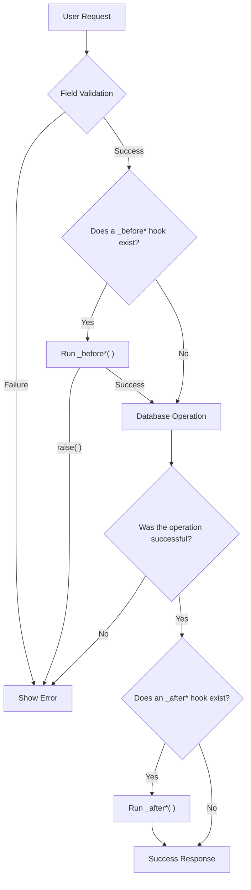

# Hooks and Lifecycle in Ragnos

In Ragnos, **hooks** let you run custom logic at different points in a dataset's lifecycle.
They are the main mechanism for **extending behavior** without breaking the declarative model.

Hooks are defined as public methods inside the controller that extends `RDatasetController`, just as in the base class. If you declare them `protected`, PHP stops the application with a fatal error, because an inherited method cannot be less visible than the original.

!!! info "Key Concept"

    The controller **does not implement CRUD** by hand. Ragnos takes care of the database operation, and you simply "hook" into key points to inject your business logic.

---

## Visual Lifecycle

Understanding the execution flow is essential to know where to place your logic.



---

## Available Hooks

Ragnos exposes the following hooks, all of them optional:

| Hook              | When it runs              |
| ----------------- | ------------------------- |
| `_beforeInsert()` | Before inserting a record |
| `_afterInsert()`  | After inserting a record  |
| `_beforeUpdate()` | Before updating a record  |
| `_afterUpdate()`  | After updating a record   |
| `_beforeDelete()` | Before deleting a record  |
| `_afterDelete()`  | After deleting a record   |

---

## Fundamental Tools and Concepts

Before writing specific functions, it is important to know the tools Ragnos provides inside hooks to work with the data and the application flow.

### 1. Basic Structure

The `_before*` hooks (Insert and Update) receive the `$data` array by reference, so you can modify values before they reach the database. If you do not need to modify any data, in some cases you can omit the argument or simply not use it.

```php
// Hook that manipulates data (by reference)
public function _beforeInsert(&$data)
{
    $data['creado_el'] = date('Y-m-d');
}
```

### 2. Accessing Values: `newValue()` and `oldValue()`

To make business logic easier, Ragnos provides helper functions to inspect the state of the data:

- **`newValue('field')`**: The value being saved (the request payload).
- **`oldValue('field')`**: The original value already stored in the database (before the change).

| Helper       | Insert | Update | Delete |
| :----------- | :----: | :----: | :----: |
| `newValue()` |   ✅   |   ✅   |   ❌   |
| `oldValue()` |   ❌   |   ✅   |   ✅   |

!!! tip "Newly inserted ID in `_afterInsert()`"

    After an insert, `newValue('<primary key>')` returns the generated ID. Ragnos exposes it through the `setInputOverride()` helper instead of writing to `$_POST`. If your own hooks need to share a computed value with the rest of the save, use `setInputOverride('field', $value)`; values are cleared at the start of every save.

### 3. Detecting Changes: `fieldHasChanged()`

This is especially useful in updates, to run an action only when a specific field has actually been modified.

```php
if (fieldHasChanged('status')) {
    // Send a status change notification
}
```

### 4. Safe Interruption: `raise()`

If you need to stop an operation because of a business rule, use `raise()`. It stops the process and shows an error message to the user, preventing the CRUD operation from continuing.

```php
if (oldValue('locked') == 1) {
    raise('A locked record cannot be modified.');
}
```

!!! tip "Design Note"

    `raise()` is preferable to `throw new Exception` for logical validation errors ("soft errors") that the user must correct.

!!! note "Refactoring and Organization"

    Although Ragnos **does not force** you to create external classes for hook logic (you can write it directly in the controller), when **business rules become complex enough**, it is advisable to refactor them into dedicated **Models**, **Libraries**, or **Services**. This keeps your code organized, reusable, and easier to maintain.

---

## Insertion Hooks

These hooks run while new records are being created.

### `_beforeInsert(&$data)`

Runs **before** the INSERT. It receives `$data` by reference.

**Common uses:**

- Initializing automatic values (dates, UUIDs).
- Normalizing data (uppercase, formats).
- Custom validations on the payload.

```php
public function _beforeInsert(&$data)
{
    // Set the creation date manually
    $data['created_at'] = date('Y-m-d H:i:s');

    // Force the RFC (tax ID) to uppercase
    if (isset($data['rfc'])) {
        $data['rfc'] = strtoupper($data['rfc']);
    }
}
```

### `_afterInsert()`

Runs **after** a successful INSERT.

**Common uses:**

- Audit logs.
- Sending welcome notifications.

```php
public function _afterInsert()
{
    // newValue() with the primary key returns the newly generated ID
    log_message('info', 'New user registered with ID ' . newValue('usu_id'));
}
```

---

## Update Hooks

These hooks handle changes to existing records. This is where most complex business logic lives.

### `_beforeUpdate(&$data)`

Runs **before** the UPDATE. It receives `$data` with the fields to update.

**Common uses:**

- Validating state transitions.
- Recording edit metadata (`updated_by`).
- Protecting critical fields.

```php
public function _beforeUpdate(&$data)
{
    // Record who modified the record
    $data['updated_by'] = session('user_id');

    // Business rule: completed tasks cannot be reopened
    if (oldValue('status') === 'completed' && newValue('status') === 'pending') {
        raise('A completed task cannot be reopened.');
    }
}
```

### `_afterUpdate()`

Runs **after** a successful UPDATE.

**Common uses:**

- Invalidating caches.
- Recalculating dependent data in other tables.

```php
public function _afterUpdate()
{
    // If the credit limit changed, invalidate the account statements cache
    if (fieldHasChanged('creditLimit')) {
        \Config\Services::cache()->delete('estadosdecuenta');
    }
}
```

---

## Deletion Hooks

These hooks handle the removal of information.

### `_beforeDelete()`

Runs **before** the DELETE.

**Common uses:**

- Validating dependencies (manual referential integrity).
- Preventing system records from being deleted.

```php
public function _beforeDelete()
{
    // Protect the Administrator user (ID 1)
    if (oldValue('usu_id') == 1) {
        raise('The main administrator user cannot be deleted.');
    }

    // Check relationships manually (for example, orders entered by the user)
    $orders = db_connect()->table('orders_log')
        ->where('user_id', oldValue('usu_id'))
        ->countAllResults();

    if ($orders > 0) {
        raise('This record cannot be deleted because it has associated data.');
    }
}
```

### `_afterDelete()`

Runs **after** the DELETE.

**Common uses:**

- Cleaning up attachments (images, documents).
- Activity logs.

```php
public function _afterDelete()
{
    log_message('info', 'Record deleted successfully.');
}
```

---

## Case Study: Password Hashing

This real example shows how to combine hooks to manage user passwords securely.

```php
// On create, the password is ALWAYS hashed
public function _beforeInsert(&$userData)
{
    $userData['usu_pword'] = \App\Libraries\Passwords::hash($userData['usu_pword']);
}

// On edit, it is hashed ONLY if the user typed a new password
public function _beforeUpdate(&$userData)
{
    if (fieldHasChanged('usu_pword')) {
        $userData['usu_pword'] = \App\Libraries\Passwords::hash($userData['usu_pword']);
    }
}
```

**Explanation:**

1. In `_beforeInsert`, the password always arrives as plain text, so it is hashed unconditionally.
2. In `_beforeUpdate`, we use `fieldHasChanged` to detect whether the user entered a new password. Without this check, the existing hash could be hashed again, corrupting the password.
3. `Passwords::hash()` uses PHP's `password_hash()` (bcrypt). Accounts created with earlier versions of Ragnos (md5) keep working, and their hash is upgraded automatically on their next login.

---

## UI Hooks

Ragnos also lets you step into the generated user interface.

### `_customFormDataFooter($id)`

Inserts HTML or scripts at the bottom of the edit form. It receives the identifier of the record being edited.

```php
protected function _customFormDataFooter($id)
{
    // Return a partial view
    return view('tienda/detalle_pedidos', ['orderId' => $id]);
}
```

---

## Best Practices

!!! success "Recommended"

    **Keep hooks small:** Complex logic belongs in Services or Libraries.

    **Document side effects:** If a hook changes another table, leave a clear comment.

    **Use `raise()`** for validation errors instead of hard exceptions.

!!! fail "To Avoid"

    **Do not replace the controller:** Hooks are meant to _extend_ the CRUD flow, not to rewrite it.

    **Be careful with manual SQL:** Use models whenever possible.

---

## Philosophy

Hooks in Ragnos let you **extend without breaking**:

- **Decoupling:** They keep hard business logic out of the generic CRUD mechanism.
- **Declarative:** They preserve the configuration-over-programming approach.
- **Maintainability:** They clearly separate "what to save" from "what to do when saving".

!!! quote "Ragnos Philosophy"

    **In Ragnos, hooks don't control the flow: they react to the domain.**
