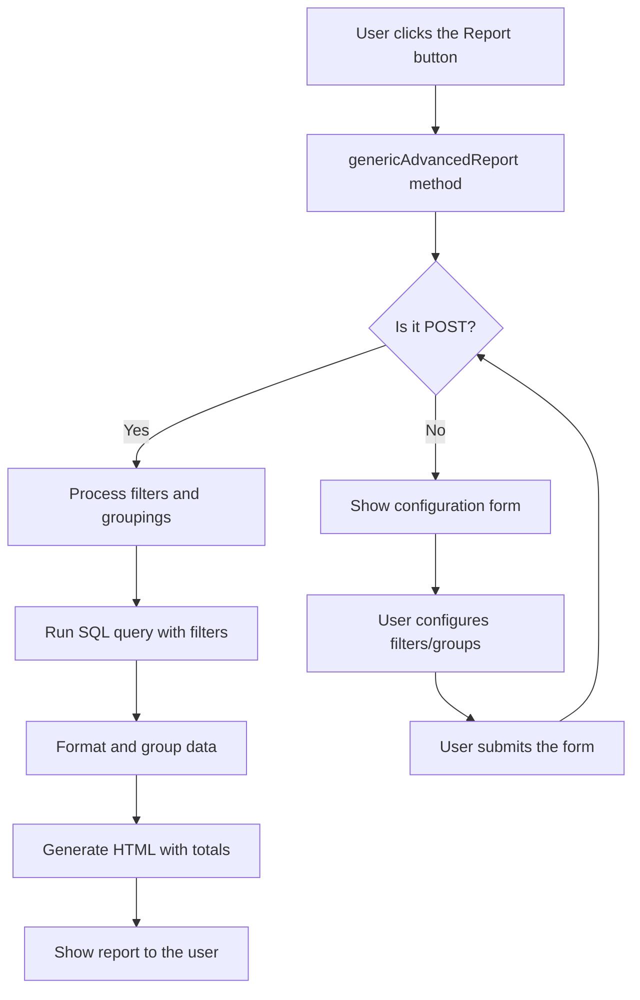

# 📊 Automatic Report Generator

## Introduction

The **Automatic Report Generator** (`RDatasetReportGenerator`) is a powerful Ragnos feature that lets you build complex, customized reports **without writing additional code**.

This functionality is **automatically built into** every dataset based on `RDatasetController`, which means any catalog you have created already has advanced reporting capabilities available from day one.

## Access from the User Interface

Every dataset based on `RDatasetController` automatically includes an **"Advanced Report"** button (printer icon 🖨️) in the table view toolbar:

```php
// Located in: src/Views/rdatasetcontroller/table_view.php
<a href="<?= site_url($clase . '/genericAdvancedReport') ?>"
    class="toolbtn btn btn-outline-secondary btn-lg bg-white shadow-sm"
    title="<?= lang('Ragnos.Ragnos_advanced_report_tooltip') ?>">
    <i class="bi bi-printer"></i>
</a>
```

Clicking this button takes the user to a report configuration screen where they can:

**Generate reports** with automatic totals and subtotals

## Premium User Experience (UX) Improvements

The generator has been updated with a modern, efficient interface that streamlines the workflow:

### 1. Compact and Efficient Design

- **Optimized Layout:** Unnecessary spacing (paddings and margins) has been reduced to show more information on less screen, ideal for configurations with many filters.
- **Sticky Header and Footer:** The "Generate Report" button and the filter toolbar are always visible (sticky), removing the need for endless scrolling.
- **Grouping Sidebar:** On large screens, the grouping configuration stays fixed on the right for quick access.

### 2. Smart Navigation and AJAX

- **Session Clearing Without Reload:** The "Clear" button now works via AJAX. It clears the filters instantly without reloading the page, which avoids "polluting" the browser history. Now, when you press the browser's **"Back"** button, you return to the previous page with a single click.
- **Professional Confirmations:** **SweetAlert2** is used for critical confirmations, offering a far more integrated and professional look than native browser dialogs.

### 3. Dynamic Visual Feedback

- **Highlight Animations:** When you add a new filter, it appears with a soft pulse animation to show where it was added.
- **Automatic Scrolling:** The screen scrolls smoothly to the newly selected filter.
- **Loading States:** The generate button shows a spinner and is disabled during processing to prevent duplicate submissions.

## Advanced Configuration Features

### 1. Smart Auto-Grouping

When you add a **Contextual Search** filter (fields defined with `addSearch()`), the system automatically tries to assign that field to the first available grouping level. This speeds up report creation, since you usually want to see the data grouped by the entity you are filtering.

### 2. Mutually Exclusive Grouping Levels

To avoid errors in the report logic, the grouping levels (Level 1, 2 and 3) are smart: if you select a field in Level 1, that option is automatically disabled in Levels 2 and 3, ensuring a logical hierarchy without duplicates.

## Main Features

### 1. Automatic Filter Generation

The generator **automatically** analyzes every field defined in your dataset through `addField()` and creates the appropriate filters according to the field type:

#### Automatically Detected Filter Types

| Field Type                      | Generated Filter Type   | Description                                |
| ------------------------------- | ----------------------- | ------------------------------------------ |
| `date` / `datetime`             | **Date Range**          | Filter from/to a specific date             |
| `money` / `numeric` / `decimal` | **Numeric Range**       | Min/max filter for numeric values          |
| `dropdown` / `enum`             | **Option Selector**     | Dropdown list with the defined options     |
| `switch` / `boolean`            | **Boolean Selector**    | Yes/No or Active/Inactive filter           |
| **Fields with `addSearch()`**   | **Contextual Search**   | Searches within the related dataset        |
| Text (others)                   | **Text Filter**         | Text match search                          |

#### Automatic Detection Example

```php
// In your Customers dataset
$this->addField('customerName', [
    'label' => 'Customer Name',
    'rules' => 'required'
]);
// → A TEXT filter will be generated

$this->addField('creditLimit', [
    'label' => 'Credit Limit',
    'rules' => 'required|money'
]);
// → A NUMERIC RANGE filter (min/max) will be generated

$this->addField('status', [
    'label' => 'Status',
    'type' => 'dropdown',
    'options' => [
        'active' => 'Active',
        'inactive' => 'Inactive',
        'suspended' => 'Suspended'
    ]
]);
// → A SELECTION filter with the defined options will be generated

$this->addSearch('salesRepEmployeeNumber', 'Tienda\\Empleados');
// → A SEARCH filter that reuses the Employees dataset will be generated
```

### 2. Automatic Grouping Generation

Grouping criteria are also generated automatically based on the field configuration:

#### Detected Grouping Types

| Field Type                    | Generated Groupings                            |
| ----------------------------- | ---------------------------------------------- |
| `date` / `datetime`           | • **By Month** (Year-Month)<br>• **By Year**   |
| **Fields with `addSearch()`** | • **By Exact Value** of the related field      |
| `dropdown` / `enum`           | • **By Exact Value** of the selected option    |

#### Automatic Grouping Example

```php
// Date field in the Orders dataset
$this->addField('orderDate', [
    'label' => 'Order Date',
    'type' => 'date',
    'rules' => 'required'
]);
// → Generates two grouping options:
//   1. "Order Date (By Month)"
//   2. "Order Date (By Year)"

// Related field in the Payments dataset
$this->addSearch('customerNumber', 'Tienda\\Clientes');
// → Generates grouping:
//   "customerNumber (Exact value)" - groups by customer
```

### 3. Multi-level Grouping

The generator supports **up to 3 levels of hierarchical grouping**, enabling complex reports such as:

- **Sales by Year → Month → Employee**
- **Payments by Customer → Year → Payment Method**
- **Products by Line → Year → Month**

Each grouping level automatically generates **subtotals**, and the report includes a **grand total**.

### 4. Contextual Search in Filters

When a field is linked to another dataset through `addSearch()`, the report filter inherits all the contextual search functionality:

**Practical Example:**

In the **Payments** dataset you have:

```php
$this->addSearch('customerNumber', 'Tienda\\Clientes');
```

And in the **Customers** dataset you defined:

```php
$this->setTableFields([
    'customerName',
    'Contacto', // Calculated field
    'salesRepEmployeeNumber' // Employee in charge
]);
```

**Result in the Report Generator:**

When filtering payments by customer, the user can search by typing:

- The company name
- The contact name
- The name of the employee in charge

The system automatically searches across all visible fields of the Customers dataset!

## Architecture and Operation

### The `RDatasetReportGenerator` Class

This class is the engine behind automatic report generation. Its responsibilities include:

1. **Field Introspection** (`detectCapabilities()`)
   - Analyzes all fields in the dataset
   - Identifies applicable filter types
   - Detects viable grouping criteria
   - Ignores unsuitable fields (primary keys, unique fields, files)

2. **Request Processing** (`processRequest()`)
   - Reads the filters and groupings submitted from the form
   - Validates and normalizes the values
   - Builds the query conditions

3. **SQL Query Generation**
   - Applies simple filters (`WHERE field = value`)
   - Applies date ranges (`WHERE date >= start AND date <= end`)
   - Applies numeric ranges (`WHERE field >= min AND field <= max`)
   - Correctly handles JOINs for related fields

4. **Formatting and Grouping** (`generateHTML()`)
   - Runs the query with all filters applied
   - Enriches the data with formatted grouping keys
   - Sorts hierarchically by the grouping levels
   - Delegates value formatting to the model (currency, dates, relationships)

5. **HTML Report Generation**
   - Uses `RSimpleLevelReport` to generate structured HTML
   - Includes automatic totals and subtotals
   - Shows a description of the applied filters

### Execution Flow



## Practical Use: Complete Example

### Orders Dataset

```php
namespace App\Controllers\Tienda;

use Ragnos\Controllers\RDatasetController;

class Ordenes extends RDatasetController
{
    public function __construct()
    {
        parent::__construct();

        $this->checkLogin();
        $this->setTitle('Purchase Orders');

        $this->setTableName('orders');
        $this->setIdField('orderNumber');

        // Date field → generates range filter + grouping by month/year
        $this->addField('orderDate', [
            'label' => 'Order Date',
            'type'  => 'date',
            'rules' => 'required'
        ]);

        // Related field → generates search filter + grouping by customer
        $this->addSearch('customerNumber', 'Tienda\\Clientes');

        // Enum field → generates selection filter + grouping by status
        $this->addField('status', [
            'label'   => 'Status',
            'type'    => 'dropdown',
            'options' => [
                'Shipped'   => 'Shipped',
                'Pending'   => 'Pending',
                'Cancelled' => 'Cancelled'
            ],
            'rules' => 'required'
        ]);

        // Calculated field (total amount)
        $this->addField('Total', [
            'label' => 'Total',
            'query' => '(SELECT SUM(quantityOrdered * priceEach)
                         FROM orderdetails
                         WHERE orderdetails.orderNumber = orders.orderNumber)',
            'rules' => 'readonly|money'
        ]);

        $this->setTableFields([
            'orderNumber',
            'orderDate',
            'customerNumber',
            'status',
            'Total'
        ]);
    }
}
```

### Automatically Generated Reports

With this configuration, the user can generate reports such as:

**Example 1: Sales by Customer in a Date Range**

- **Filter:** Date from 2024-01-01 to 2024-12-31
- **Grouping:** By Customer
- **Result:** List of customers with the total sold to each one in 2024

**Example 2: Cancelled Orders by Month**

- **Filter:** Status = "Cancelled"
- **Level 1 Grouping:** By Month
- **Result:** Total cancelled orders grouped by month with subtotals

**Example 3: Annual Hierarchical Analysis**

- **Level 1 Grouping:** By Year
- **Level 2 Grouping:** By Month
- **Level 3 Grouping:** By Status
- **Result:** Hierarchical report: Year → Month → Status with all subtotals

## System Advantages

### 1. **Zero Additional Configuration**

You don't need to write special controllers, views or queries for reports. Everything is generated automatically from the dataset definition.

### 2. **Logic Reuse**

Filters and groupings reuse:

- The validations defined in `addField()`
- The relationships defined with `addSearch()`
- The formatting defined in the model

### 3. **Interface Consistency**

Every dataset has exactly the same reporting interface, reducing the learning curve for users.

### 4. **Total Flexibility**

End users can combine any filter with any grouping, producing ad-hoc reports to suit their needs without requiring development.

### 5. **Scalability**

As you add more fields to your dataset, the available filter and grouping options grow automatically.

## Limitations and Considerations

### Automatically Excluded Fields

The system automatically **ignores** certain field types for filters and groupings:

- **Primary keys**: Rarely useful for general filters
- **Fields with `is_unique`**: Intended for unique identifiers
- **Files and images** (`fileupload`, `imageupload`)
- **Passwords** (`password`)

### Calculated Fields and Groupings

Fields with `query` (calculated) can appear in the report, but **cannot be used as a grouping criterion** because they are derived SQL expressions.

### Performance with Large Volumes

For datasets with millions of records, consider:

- Adding indexes on frequently filtered fields
- Limiting grouping options if they are very expensive
- Implementing pagination or limits on the query if needed

## Advanced Customization

Although the generator is automatic, you can influence its behavior:

### Controlling Which Fields Are Filterable

By defining fields as `hidden` or with specific rules, you can control whether they appear in filters:

```php
// This field will NOT appear in filters (it is hidden and calculated)
$this->addField('internalCode', [
    'label' => 'Internal Code',
    'type'  => 'hidden',
    'query' => 'MD5(customerNumber)'
]);
```

### Programmatic Methods

You can also use the generator programmatically from code:

```php
public function customReport()
{
    $generator = new RDatasetReportGenerator($this);

    // Add filters manually
    $generator->addDateRangeFilter('orderDate', '2024-01-01', '2024-12-31');
    $generator->addFilter('status', 'Shipped');

    // Configure grouping
    $generator->setGrouping('customerNumber', 'raw', 'Customer');
    $generator->setGrouping('orderDate', 'date_month', 'Month');

    // Generate HTML
    $html = $generator->generateHTML();

    return view('my_report_template', ['contenido' => $html]);
}
```

## Integration with the Ragnos Ecosystem

### Relationship with `addSearch()`

As mentioned in the [Datasets guide](../datasets/datasets.md#relationships-between-datasets-addsearch), fields defined with `addSearch()` not only create selectors in forms, they also:

1. **In Report Filters:** Enable advanced contextual search
2. **In Groupings:** Automatically become grouping criteria

This synergy makes defining relationships doubly powerful.

### Relationship with `setTableFields()`

The fields included in `setTableFields()` are the ones that appear in the generated report. This gives you control over which columns are shown without affecting the availability of filters and groupings.

## Conclusion

The **Automatic Report Generator** is one of Ragnos's most powerful features, turning every simple dataset into an advanced analysis tool with no additional development effort.

By leveraging all the declarative metadata you define in your dataset (`addField`, `addSearch`, `setTableFields`), the system automatically builds a complete reporting interface with:

- ✅ Smart filters by field type
- ✅ Multi-level hierarchical groupings
- ✅ Contextual search in relationships
- ✅ Automatic totals and subtotals
- ✅ Consistent interface across all modules

**Result:** Professional-quality business reports, available in minutes, not weeks.
